<div align="center">


# Fox

**A personal AI assistant for Windows 11 that asks before it acts.**

Chat or talk to Fox, and it opens apps, manages files, reads your documents and images, analyses web traffic, reads and sends email, searches the web and sets reminders on your own computer. Every action goes through a permission gate you control, and a kill switch stops everything at once.

[](https://github.com/Agni-glitch/assistent/actions/workflows/ci.yml)
[](LICENSE)


[Getting started](docs/getting-started.md) ·
[User guide](docs/user-guide.md) ·
[Models](docs/models.md) ·
[Writing plugins](docs/plugins.md) ·
[Security model](docs/security-model.md) ·
[Limitations](docs/limitations.md) ·
[Contributing](CONTRIBUTING.md)

<br>

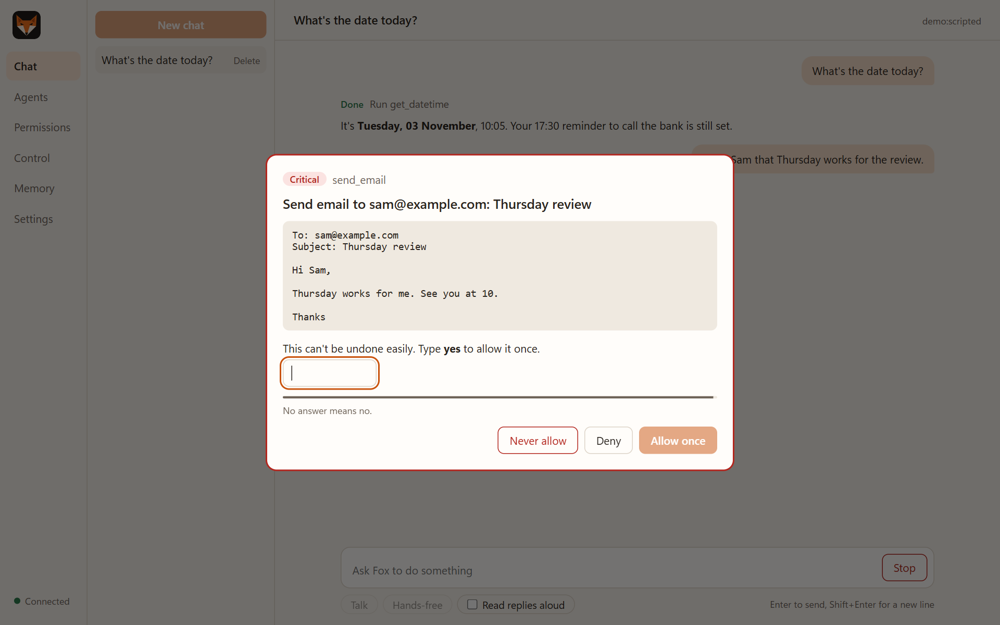

<sub>A critical action: Fox shows exactly what it will send and waits for you to type <b>yes</b>.</sub>

</div>

---

## Why Fox

Most assistants that can act on your computer either do too little or ask too little. Fox is built around one rule: **nothing happens on your machine without passing a permission check you can see and control.**

- **Permission-first.** Every tool call is rated *safe*, *normal* or *critical*. Normal actions ask once and can be remembered per target; critical ones (sending email, deleting, PowerShell, typing keys) ask **every** time. No answer means no.
- **You hold the controls.** A kill switch, per-tool on/off switches and a full decision log. None of them is reachable by the model or any tool.
- **Local-first.** Fox runs on your computer. Chats, memory and permissions stay in a local folder. Data leaves only for the AI providers you configure and the web requests you approve.
- **Any model, with fallback.** Azure OpenAI, OpenAI, Anthropic, Google Gemini, Groq, a local Ollama model, or any OpenAI-compatible server you add, such as OpenRouter, DeepSeek or LM Studio. If one fails, Fox moves to the next. Pick a model per chat, and a separate order for images.
- **Extensible.** Add a tool with a single decorated Python function, or describe a specialist agent in a few lines of YAML. Both load without a restart.
- **Voice.** Push-to-talk or hands-free with a wake word, with offline speech recognition and offline text-to-speech available.

## Features

| | |
|---|---|
| **Desktop app** | Chat, agents, permissions, control panel, memory and settings in one window (WebView2). |
| **Terminal** | `fox chat`, `fox voice` and management commands for everything the app does. |
| **53 built-in tools** | Apps and windows, files, web search and pages, email (SMTP/IMAP), volume, brightness, media, clipboard, screenshots, notifications, reminders, memory, PowerShell, network traffic analysis. |
| **Attachments** | Attach documents (PDF, Word, text, code, CSV), images and HAR files in chat with **+**, drag and drop, or paste. Images go to models that can see. |
| **Your own models** | Add any model on the **Models** page, test it, and use it in the fallback order, for one chat, or for an agent. |
| **Browser capture** | A Chrome extension (included) sends a tab's requests and responses to Fox, which removes secrets and analyses them. |
| **Clear reports** | Replies render Markdown with task checklists and a progress bar, so a list of jobs shows what's done, not done and failed. |
| **Specialist agents** | YAML-defined agents with their own prompt, tool allow-list and model chain. Fox delegates to them. |
| **Plugins** | Python files in `plugins/`, hot-reloaded, behind the same permission gate. |
| **Local API** | Authenticated REST and WebSocket API on `127.0.0.1` for building your own front end. |
| **Prompt-injection hardening** | Content from web pages, emails and files is marked as untrusted data. |
| **One-command build** | `build.bat` produces `Fox.exe` and a shortcut, after running the tests and a self-check. |

## Screenshots

<table>
  <tr>
    <td colspan="2">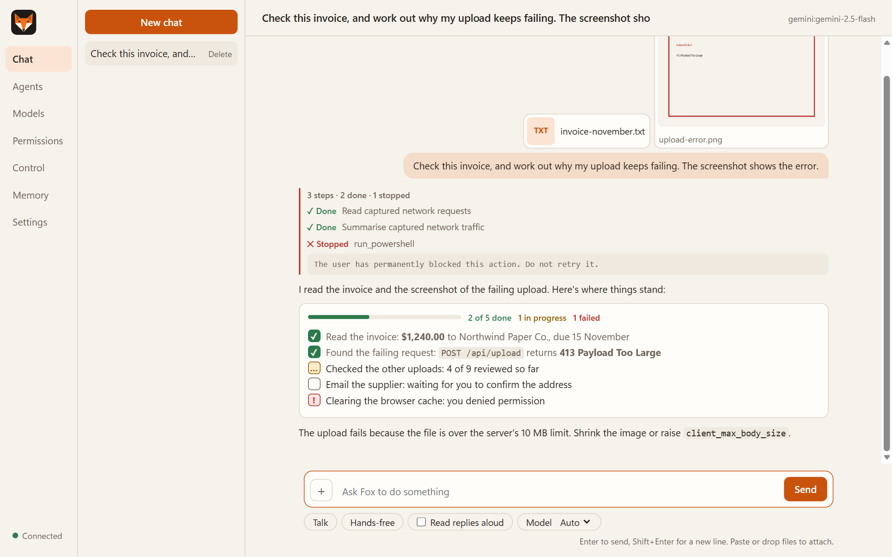</td>
  </tr>
  <tr>
    <td colspan="2"><b>Attachments and checklists.</b> Attach documents and images. When Fox works through several jobs, it ends with a checklist of what's done, in progress, not done and failed.</td>
  </tr>
  <tr>
    <td width="50%">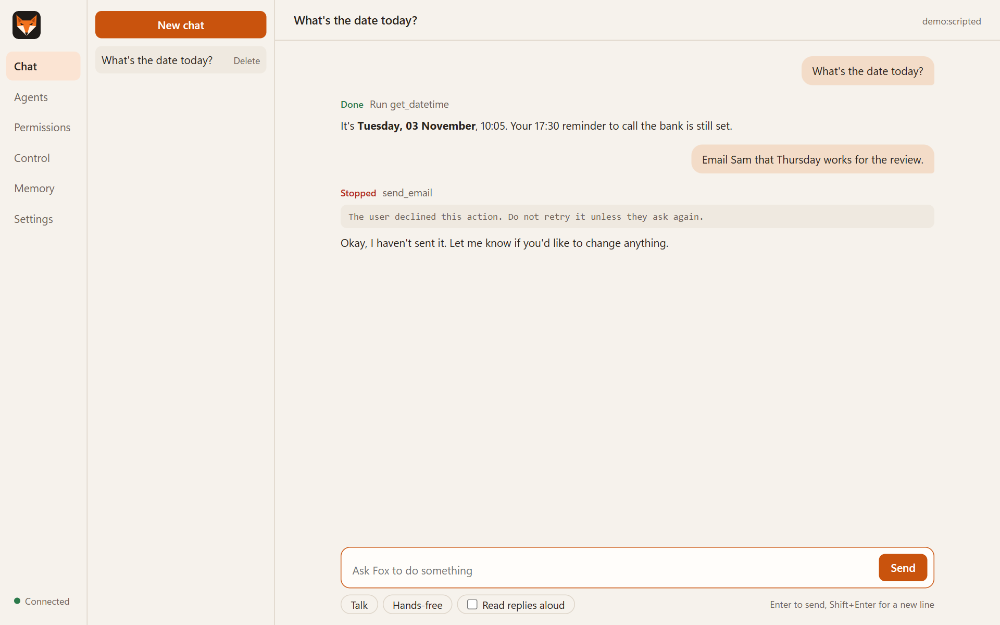</td>
    <td width="50%">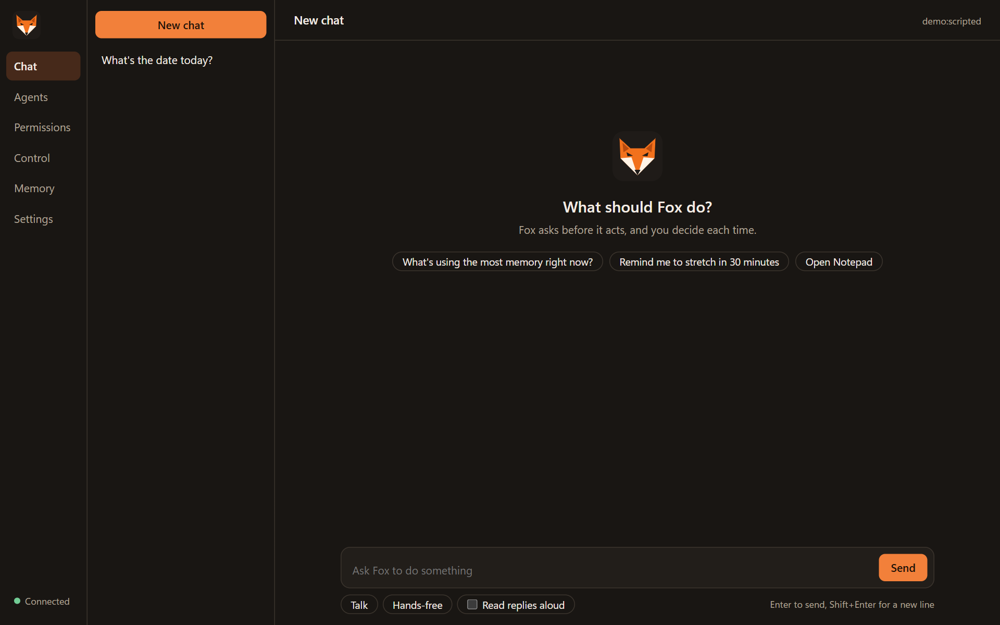</td>
  </tr>
  <tr>
    <td><b>Chat.</b> Every action is shown in order, including ones you declined.</td>
    <td><b>Dark theme.</b> Follows Windows, or set it in Settings.</td>
  </tr>
  <tr>
    <td>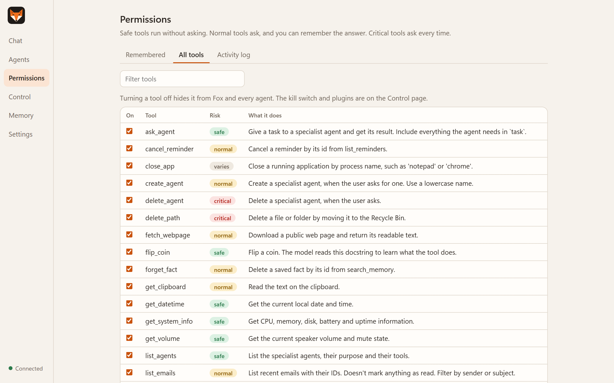</td>
    <td>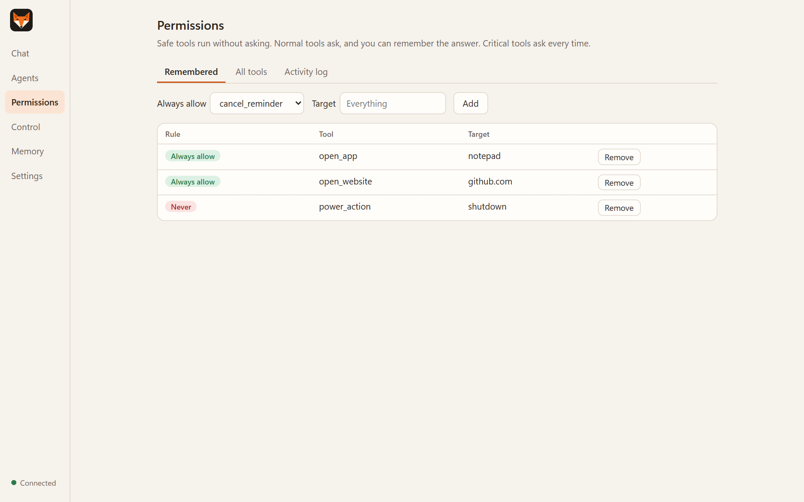</td>
  </tr>
  <tr>
    <td><b>All tools.</b> The risk level of every tool, and a switch to turn any of them off.</td>
    <td><b>Remembered answers.</b> Each rule covers one tool and one target, and can be removed.</td>
  </tr>
  <tr>
    <td>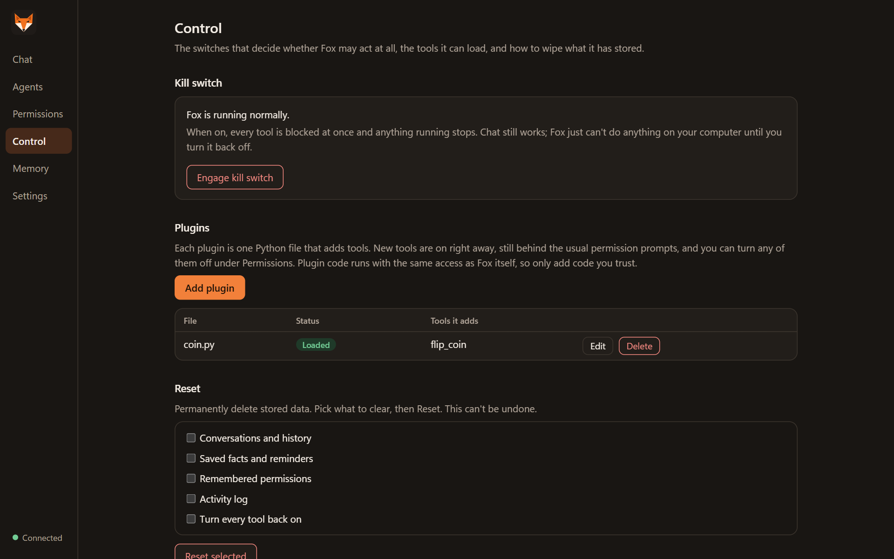</td>
    <td>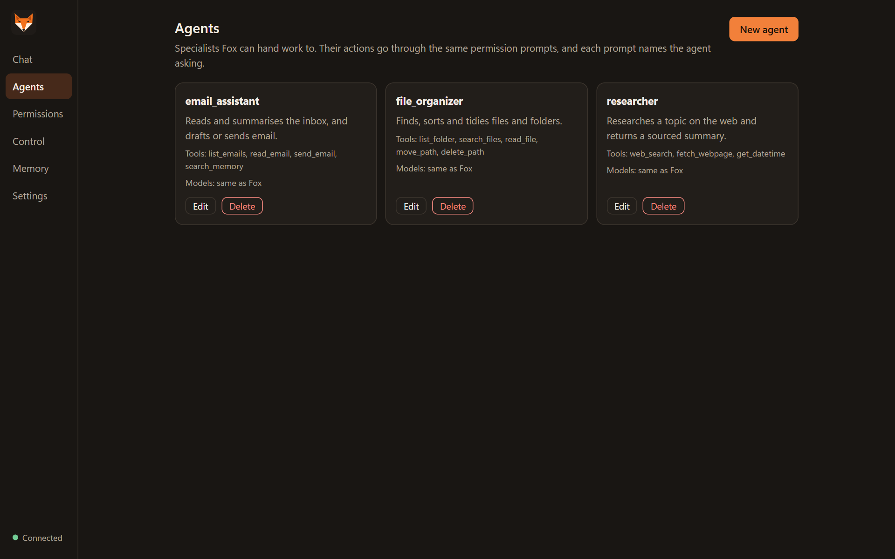</td>
  </tr>
  <tr>
    <td><b>Control.</b> Kill switch, plugins and data reset, out of the model's reach.</td>
    <td><b>Agents.</b> Specialists with their own tools, created in the app or in YAML.</td>
  </tr>
  <tr>
    <td>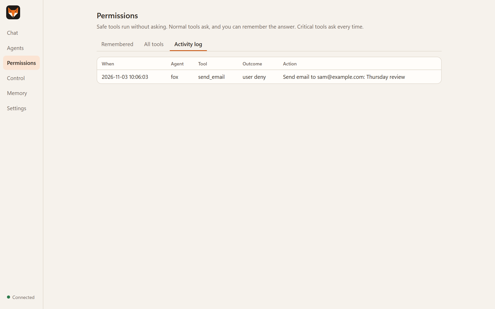</td>
    <td>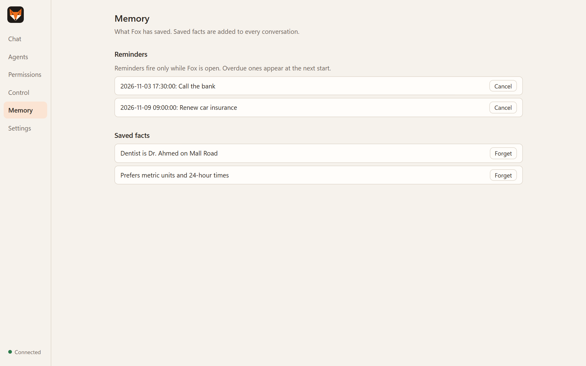</td>
  </tr>
  <tr>
    <td><b>Activity log.</b> Every permission decision, with who asked and what for.</td>
    <td><b>Memory.</b> Reminders and saved facts, which you can cancel or forget.</td>
  </tr>
</table>

<sub>Screenshots use a scripted demo model and sample data.</sub>

## Quick start

Requirements: Windows 11, [uv](https://docs.astral.sh/uv/getting-started/installation/), and an API key for at least one model provider (or a local [Ollama](https://ollama.com) model).

```powershell
git clone https://github.com/Agni-glitch/fox.git
cd fox
uv sync --all-extras
copy .env.example .env      # then add at least one API key
uv run fox doctor           # shows which models and features are ready
uv run fox gui              # or: uv run fox chat
```

To build the desktop app instead, run `.\build.bat`. It installs dependencies, runs the tests and creates `Fox.exe` and a `Fox.lnk` shortcut. Open Fox, go to **Models**, add a key under **Provider keys** and click **Save changes**.

Full instructions: [docs/getting-started.md](docs/getting-started.md).

## How it works

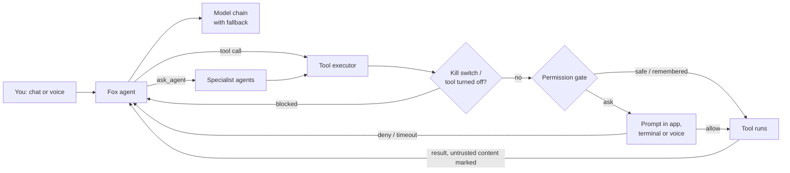

See [docs/architecture.md](docs/architecture.md) for the module layout.

## Use cases

- *"Open Spotify and set the volume to 30%."*
- *"Find every PDF invoice in Downloads from this year and move them to Documents\Invoices."*
- *"Summarise my five latest emails, then reply to the one from my landlord saying Thursday works."*
- *"Research the best budget mechanical keyboards and give me three options with links."*
- *"Remind me at 5:30 pm to call the bank."*
- *"Here's the contract (attached PDF). List every deadline in a table."*
- *"Analyse the captured traffic from the checkout page. Why does the order request fail?"*
- Hands-free: *"Fox, pause the music."*

More, including agent and plugin ideas: [docs/use-cases.md](docs/use-cases.md).

## Extending Fox

**A tool** is a Python function in `plugins/`:

```python
from fox.core.permissions import Risk
from fox.core.tooling import fox_tool

@fox_tool(risk=Risk.SAFE)
def flip_coin() -> str:
    """Flip a coin and return heads or tails."""
    import random
    return random.choice(["heads", "tails"])
```

**An agent** is a YAML file in `agents/`:

```yaml
name: travel_planner
description: Plans trips and compares options.
system_prompt: |
  You plan trips. Compare options and give clear recommendations.
tools: [web_search, fetch_webpage]
```

Guides: [Writing plugins](docs/plugins.md) · [Creating agents](docs/agents.md).

## Documentation

| Guide | Contents |
|---|---|
| [Getting started](docs/getting-started.md) | Install, first run, where data lives |
| [User guide](docs/user-guide.md) | The desktop app, voice, terminal commands, email |
| [Configuration](docs/configuration.md) | Every `.env` setting, model and voice providers |
| [Models](docs/models.md) | Adding models, the fallback order, models for images, choosing a model per chat |
| [Browser capture](docs/browser-capture.md) | Analysing requests and responses from Chrome, the included extension, and the capture API |
| [Security model](docs/security-model.md) | Permission levels, the kill switch, what tools can't touch |
| [Writing plugins](docs/plugins.md) | The plugin API in depth, with patterns and a checklist |
| [Creating agents](docs/agents.md) | Specialist agents and how delegation works |
| [Local API](docs/api.md) | REST and WebSocket reference |
| [Building Fox.exe](docs/building.md) | Packaging the desktop app |
| [Architecture](docs/architecture.md) | How the code is organised |
| [Use cases](docs/use-cases.md) | What Fox is good at, with examples |
| [Limitations](docs/limitations.md) | Known issues, trade-offs and troubleshooting |

## Project status

Fox is **alpha** software (v0.1). It works day to day, but expect rough edges and breaking changes to the plugin API before 1.0. Read [Limitations](docs/limitations.md) before relying on it, and remember that approving a critical action gives it your full account access.

## Contributing

Contributions are welcome: bug reports, plugins, agents, docs and code. Start with [CONTRIBUTING.md](CONTRIBUTING.md). Please report security issues privately as described in [SECURITY.md](SECURITY.md), not in public issues.

## License

Fox is released under the [MIT License](LICENSE).

Fox uses third-party libraries under their own licenses, including LangChain, FastAPI, pywebview, faster-whisper and pyttsx3. A built `Fox.exe` bundles them; their license files are kept in the `_internal` folder.
