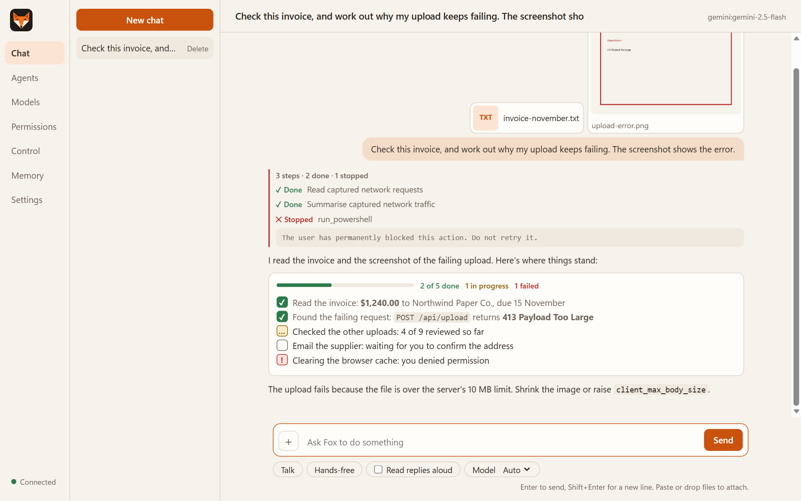
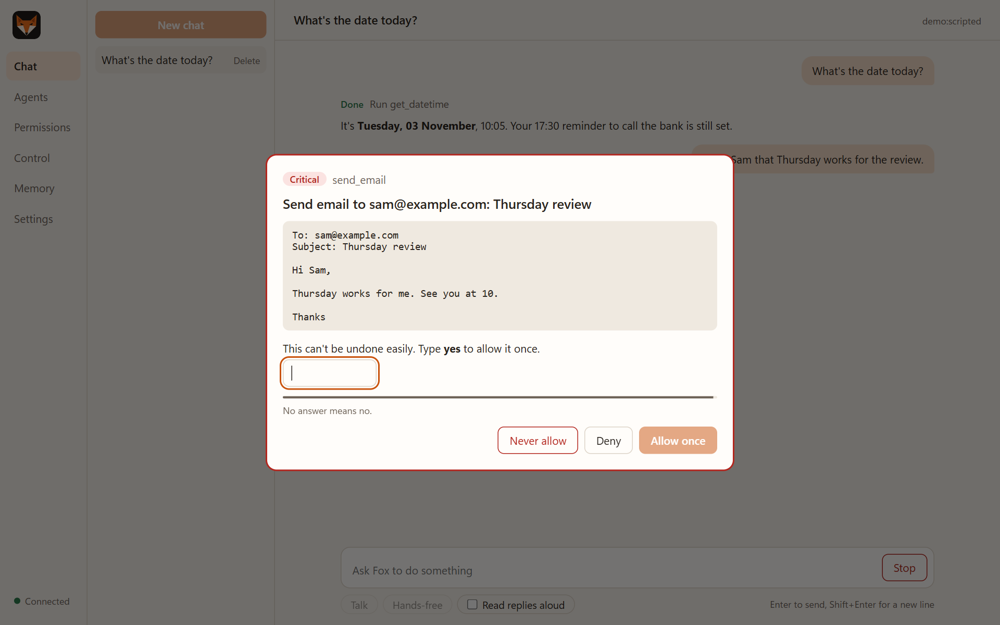
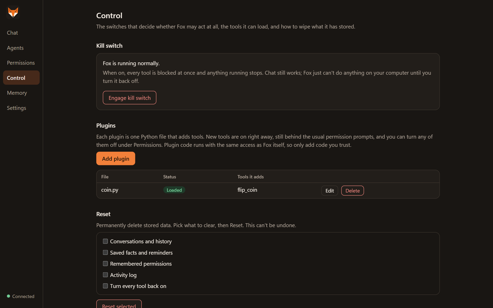

# User guide

How to use Fox day to day: the desktop app, voice, the terminal and email. For setup, see [Getting started](getting-started.md).

- [The desktop app](#the-desktop-app)
- [Attaching files](#attaching-files)
- [Reading Fox's replies](#reading-foxs-replies)
- [Permission prompts](#permission-prompts)
- [Control: kill switch, tools, plugins, reset](#control)
- [Voice](#voice)
- [Terminal commands](#terminal-commands)
- [Email](#email)
- [Built-in tools](#built-in-tools)

## The desktop app

Open it with `Fox.lnk`, `Fox.exe` or `uv run fox gui`.

| Page | What it does |
|---|---|
| **Chat** | Your conversations, with each action Fox takes shown in order. Open an action to see its result. Attach files with **+**, and pick a model with the **Model** menu. |
| **Agents** | Create, edit and delete specialist agents. See [Creating agents](agents.md). |
| **Models** | Provider keys, the fallback order, and models you add yourself, each with a **Test** button. See [Models](models.md). |
| **Permissions** | Remembered answers, every tool with an on/off switch and its risk level, and the log of decisions. |
| **Control** | The kill switch, the plugins Fox has loaded, and buttons to wipe stored data. |
| **Memory** | Pending reminders and saved facts. Cancel or forget any of them. |
| **Settings** | Voice, email, browser capture, advanced behaviour and theme. Changes apply as soon as you save. |

Fox runs one copy at a time; opening it again brings the open window to the front. Task Manager shows two `Fox.exe` processes: one is the app, the other restarts it if Windows stops it while its window is opening (see [Limitations](limitations.md#known-issues)). Closing the window stops Fox, and with it any reminders.

## Attaching files

Click **+** next to the message box, drag files onto the chat, or paste an image or file into the message box. Up to 10 files at a time, each up to `FOX_MAX_UPLOAD_MB` (20 MB). Remove one with its **×** before sending.

| You attach | Fox gets |
|---|---|
| A document: PDF, Word (`.docx`), text, Markdown, CSV, JSON, code, logs | Its text, marked as untrusted data. Long documents are cut at `FOX_MAX_ATTACHMENT_CHARS` (40,000 characters), and Fox reads the rest with `read_attachment` when it needs it. |
| An image: PNG, JPEG, GIF, WebP, BMP | The image itself, shrunk to 2048 pixels on the longest side. It goes to a model that can see; see [Models](models.md#images-and-documents). |
| A HAR file | Imported into the captured network traffic, for the network tools. See [Browser capture](browser-capture.md). |

A file Fox can't read (a binary file, a scanned PDF with no text, a broken image) is refused when you attach it, with the reason. Attachments are stored in `data/uploads`, which tools can't reach, and are deleted with their conversation.

## Reading Fox's replies

Replies are shown as Markdown: headings, lists, tables, links and code blocks, each with a **Copy** button.

When you give Fox several jobs, or one job takes several steps, it ends with a checklist:

```markdown
- [x] Opened Notepad
- [ ] Sent the email (no address yet)
- [~] Organised Downloads (12 of 30 files moved)
- [!] Emptied the temp folder: permission denied
```

The app shows each line with a tick, an empty box, a dot or a warning, and adds a progress bar with *1 of 4 done · 1 in progress · 1 failed*. Fox ticks a job only when a tool result confirmed it. In tables, a cell that just says *Done*, *Failed*, *In progress* or *Pending* is shown as a coloured label.

Actions that follow each other are grouped, headed by a count such as *3 steps · 2 done · 1 stopped*.



## Permission prompts

When Fox wants to do something that isn't harmless, it stops and asks. The taskbar button flashes if the window is behind others.



| Button | Effect |
|---|---|
| **Allow once** | Runs this one call. |
| **Allow this session** | Allows the same tool on the same target until Fox closes. |
| **Always allow** | Allows the same tool on the same target from now on. |
| **Deny** | Refuses this one call. |
| **Never allow** | Refuses the same tool on the same target from now on. |

Safeguards against approving by accident:

- **Deny** has the keyboard focus, and the buttons wait a moment before they work, so a stray Enter or click can't approve anything.
- **Critical actions** need `yes` typed out and offer no "session" or "always" option.
- **The bar** shows the time left. No answer means no.

A "target" is what the action is about: an app name, a website host, a folder, an email recipient. "Always allow" for opening Notepad doesn't cover opening anything else. The full rules are in [Security model](security-model.md).

## Control

The **Control** page holds the switches you keep for yourself. The model and its tools can't reach any of them.



**Kill switch.** One toggle that stops Fox acting. While it's on, every tool is blocked, even safe ones and anything you've already allowed, and whatever was running is cancelled at once. Chat still answers; Fox just can't touch your computer. A red banner stays across the top until you turn it off. From a terminal: `fox kill on`, `fox kill off`, `fox kill status`. A running app picks up the change within moments.

**Tools on and off.** Under **Permissions → All tools**, each tool has a switch. A tool that's off is hidden from Fox and from every agent, so nothing can call it. Built-in and plugin tools can both be turned off, and the choice survives restarts.

**Plugins.** Add, edit and delete plugin tools without restarting. **Add plugin** opens an editor; saving writes the file to `plugins/` and loads it at once. If it has an error, the file is kept and the page shows what went wrong. See [Writing plugins](plugins.md).

**Reset.** Tick what to clear (conversations and history, saved facts and reminders, remembered permissions, the activity log, or turning every tool back on), then **Reset selected**. It asks for confirmation and can't be undone.

## Voice

Voice runs inside Fox, so the app doesn't need browser microphone access.

| Control | What it does |
|---|---|
| **Talk** | Listens once, then answers out loud. |
| **Hands-free** | Keeps listening for the wake word (`fox` by default). Say "goodbye Fox" or click it again to stop. Typing is off while it's on. |
| **Read replies aloud** | Speaks the answers to messages you type. |
| **Stop** | Ends the current reply and frees the microphone. |

During Talk and Hands-free, you can answer permission prompts by voice or on screen, and whichever comes first counts:

- Say **"yes"**, **"always"** or **"no"**.
- Critical actions need the word **"confirm"**, and any negative word refuses.
- If Fox can't make out what you said, the prompt stays open on screen.

In the terminal: `fox voice` (press Enter, then speak) or `fox voice --wake` (hands-free: *"Fox, open Notepad"*). Test your voice output with `fox say "hello"`.

Voice engines and their settings are in [Configuration](configuration.md#voice-output).

## Terminal commands

Put `uv run` in front of each command, or activate `.venv` first.

| Command | What it does |
|---|---|
| `fox gui` | Open the desktop app without building it. |
| `fox chat [--session ID]` | Chat in the terminal, optionally resuming a conversation. |
| `fox voice [--wake]` | Talk to Fox; `--wake` listens for the wake word. |
| `fox say "text"` | Speak text with your voice settings. |
| `fox doctor` | Show which models and features are ready. |
| `fox serve` | Run the [local API](api.md) without the desktop app. |
| `fox tools` | List every tool and its risk level. |
| `fox sessions` | List saved conversations. |
| `fox kill on` / `off` / `status` | The kill switch. |
| `fox agents list` / `add` / `remove` | Manage specialist agents. |
| `fox permissions list` / `grant` / `revoke` / `audit` | Manage remembered answers and see the decision log. |

Inside `fox chat`:

| Command | What it does |
|---|---|
| `/new` | Start a new conversation. |
| `/models` | Show the model fallback order. |
| `/tools`, `/agents` | List tools or agents. |
| `/permissions` | Show remembered answers. |
| `/grant TOOL [TARGET]`, `/revoke TOOL [TARGET]` | Allow or forget a tool, for one target or all of them. |
| `/exit` | Quit. |

## Email

Fox uses standard SMTP to send and IMAP to read, so it works with most providers.

**Gmail:**

1. Turn on 2-Step Verification for your Google account.
2. Create an App Password at <https://myaccount.google.com/apppasswords>.
3. In `.env` (or **Settings → Email**), set `EMAIL_ADDRESS` and put the App Password in `EMAIL_PASSWORD`.

**Other providers:** also set `SMTP_HOST`, `SMTP_PORT`, `IMAP_HOST` and `IMAP_PORT` from your provider's help pages.

Reading email asks permission per folder and never marks messages as read. Sending is critical, so it asks every time and shows the full message. Email content is treated as untrusted data; see [Security model](security-model.md#prompt-injection).

## Built-in tools

Run `fox tools` for the live list. "Varies" means the risk depends on the arguments; for example, closing an app is normal, but force-closing it is critical.

| Area | Tools |
|---|---|
| Apps | `open_app`, `close_app` (varies), `list_running_apps`, `list_installed_apps` |
| Windows and input | `list_windows`, `window_action`, `type_text` (critical), `press_keys` (critical), `take_screenshot` |
| Files | `list_folder`, `search_files`, `read_file`, `write_file` (varies), `move_path`, `delete_path` (critical), `open_path` (varies) |
| Web | `web_search`, `fetch_webpage`, `open_website` |
| Email | `list_emails`, `read_email`, `send_email` (critical) |
| System | `get_datetime`, `get_system_info`, `get_volume`, `set_volume`, `set_mute`, `set_brightness`, `media_control`, `open_settings`, `lock_screen`, `power_action` (varies), `show_notification` |
| Clipboard | `get_clipboard`, `set_clipboard` |
| PowerShell | `run_powershell` (critical) |
| Memory and reminders | `remember_fact`, `search_memory`, `forget_fact`, `set_reminder`, `list_reminders`, `cancel_reminder` |
| Agents | `ask_agent`, `list_agents`, `list_tools`, `create_agent`, `delete_agent` (critical) |
| Network traffic | `summarize_network_traffic`, `list_network_requests`, `get_network_request`, `import_har_file`, `clear_network_requests` |
| Attachments | `read_attachment` |

## Good to know

- Reminders fire only while Fox is running. Overdue ones appear as Windows notifications at the next start.
- If something goes wrong, click **Open log** in Settings, or open `data/fox.log`.
- More answers in [Limitations and troubleshooting](limitations.md).
